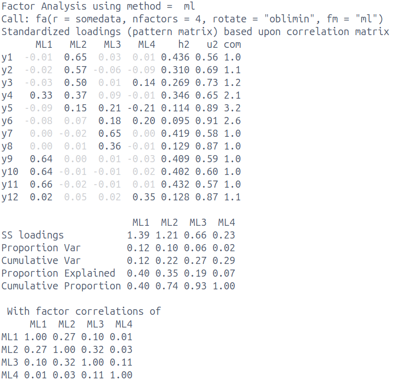

```{r}
#| label: setup
#| include: false
source('assets/setup.R')

library(tidyverse)
library(patchwork)
library(lme4)
library(lmerTest)


qcounter <- function(){
  if(!exists("qcounter_i")){
    qcounter_i <<- 1
  }else{
    qcounter_i <<- qcounter_i + 1
  }
  qcounter_i
}

vars <- readRDS("week_sols.rds")
# set params manually rather than yaml params
params <- list(
  SHOW_SOLS = tryCatch({ vars$sols[[tools::file_path_sans_ext(knitr::current_input(dir=FALSE))]]},
                       error = function(e) { TRUE } ),
  TOGGLE = TRUE
)
```

:::{.callout-note}
### Get set up

1. Create a new .Rmd file for this week's exercises.
1. Save it somewhere you can find it again.
1. Give it a clear name (for example, `dapr3_lab10.Rmd`).
:::

---


<!-- # q1 -->

`r qbegin("Q1 - EFA [14 marks]", qlabel=F)`
```{r}
#| echo: false
m = "
  lv1 =~ .8*y1 + .6*y2 + .6*y3 + .7*y4
  lv2 =~ .7*y5 + .8*y6 + .9*y7 + .7*y8
  lv3 =~ .8*y9 + .8*y10 + .9*y11 + .4*y4
  lv4 =~ .9*y12
  lv1 ~~.2*lv2
  lv1 ~~.2*lv3
  lv2 ~~.2*lv2
"
eseed=round(runif(1,1e3,1e6))
set.seed(167807)
df = lavaan::simulateData(m,sample.nobs = 500)
library(psych)
somedata <- df
mm = fa(somedata, nfactors = 4, rotate="oblimin",fm="ml")
```

Below are the results of a data reduction of a set of 12 items assessing environmental conscientiousness. Participants are asked to respond to each statement on a 5-point likert scale from "Strongly Disagree" to "Strongly Agree". 

Based on the results and the item descriptions below, provide an interpretation of the factor solution. Your description should include: 

a. Describe the factor model that has been fitted **[2 marks]**  
b. Describe the numerical solution of the fitted model **[4 marks]**  
c. Discuss the suitability of the selected number of factors **[4 marks]**   
d. Suggest and justify possible next steps **[2 marks]**   
e. Label and define the factors **[3 marks]**  


```{r}
#| echo: false
#| out-width: "60%"

```

::::{.columns}
:::{.column width="50%"}

```{r}
#| echo: false
tribble(
  ~item, ~wording,
  "y1","I recycle regularly",
  "y2","I use eco-friendly transportation",
  "y3","I buy sustainable products",
  "y4","I know how to reduce my carbon footprint",
  "y5","Protecting resources matters to me",
  "y6","I care about protecting the environment"
) |> gt::gt()
```
:::

:::{.column width="50%"}

```{r}
#| echo: false
tribble(
  ~item, ~wording,
  "y7","I feel responsible for my environmental impact",
  "y8","I am worried about climate change effects",
  "y9","I know about the harm of single-use plastics",
  "y10","I know how deforestation affects climate change",
  "y11","I know about relevant environmental policies",
  "y12","Wildlife destruction concerns me deeply",
) |> gt::gt()
```
:::
::::


`r qend()`
`r solbegin(show=params$SHOW_SOLS, toggle=params$TOGGLE)`

:::imp
__Important__  
This is not a "rubric", in the sense that 
a) it is not an exhaustive list of possible things that could be mentioned and b) the bullet points below are not mapped to "marks"
:::

a. Describe the factor model that has been fitted  

    - 12 items, 4 factors extracted
    - oblique rotation allowing factors to correlate
    - estimated with maximum likelihood
  
b. Describe the numerical solution of the fitted model  

    - explains 29% variance
    - Factors ML2 & ML1 both have $\geq 3$ salient/primary loadings
        - (salient = $\geq |0.3|$)
    - 3 complex items (y4, y5, y6)
    - some items (y5,y6) have no salient loadings
    - Factors ML1,2,3 correlated weak-moderate
    - Factor ML4 not strongly correlated with others

c. Discuss the suitability of the selected number of factors  

    - probably overextracting (too many factors)
    - because = lack of clarity/definition of ML3 & 4
        - both have only 1 item with salient loading
        - 3rd factor explaining only 6%, 4th factor only 2%
        - SSloadings for ML3 & ML4 are <1
    - complex items y5 & y6 are spread across ML3 & ML4 - a 3 factor solution may well make more sense

d. Suggest and justify possible next steps  

    - examine a 3 factor solution
    - item y4 = one to keep an eye on and possibly remove if still complex
    - once satisfactory solution obtained, collect data on new sample and test if model replicates

e. Label and define the factors  

    - ML1 = "environmental knowledge"
    - ML2 = "environmental behaviours"
    - ML3/4 not well defined enough to name
    - combined ML3/4 look like might become "environmental concern". 

`r solend()`


<!-- # q2 -->

`r qbegin("Q2 - SSloadings [6 marks]", qlabel=F)`

Calculate the 6 values missing from the table below: SSloadings **[2 marks]** and proportion variance **[2 marks]** & cumulative variance **[2 marks]**.  

```{r}
#| echo: false
set.seed(67768)
nitem <- 5
A <- matrix(runif(nitem^2,.41,1)*2-1, ncol=nitem) 
scor <- t(A) %*% A
df <- MASS::mvrnorm(n=220,mu=rep(0,5),Sigma = scor) |> as.data.frame()
loadings = psych::principal(df,nfactors=2, rotate="none")$loadings[,1:2]
loadings[1:4,1] = round(loadings[1:4,1],1)
loadings[5,1] = round(loadings[5,1],2)
loadings[c(1,3:5),2] = round(loadings[c(1,3:5),2],1)
loadings[2,2] = round(loadings[2,2],2)

vac <- psych::principal(df,nfactors=2, rotate="none")$Vaccounted[1:3,]
vac[1:3,1:2] <- " __ "

rownames(loadings) = paste0("item",1:5)
loadings
noquote(vac)
```

`r qend()`
`r solbegin(show=params$SHOW_SOLS, toggle=params$TOGGLE)`

Table filled in:
```{r}
#| echo: false
vv = as.data.frame(rbind(
  apply(loadings,2,\(x) sum(x^2)),
  apply(loadings,2,\(x) sum(x^2))/5,
  cumsum(apply(loadings,2,\(x) sum(x^2))/5)
))
rownames(vv) = rownames(vac)
vv
```

How?   
start by squaring all the numbers, and sum the columns to give us SSloadings:
```{r}
#| echo: false
loadings^2 |>
  addmargins(margin=1)
```

divide SSloadings by 5 (because 5 observed variables) to get proportion variance
```{r}
#| echo: false
colSums(loadings^2) / 5
```

those two numbers are then cumulatively summed for cumulative variance:
```{r}
#| echo: false
cumsum(colSums(loadings^2) / 5)
```


`r solend()`


<!-- # q3 -->

`r qbegin("Q3 - LMM interpretation [12 marks]", qlabel=F)`

A company that makes "six-minute journals" is interested in finding out whether regular use of their product helps alleviate anger in people who struggle with anger management.

They recruited 200 people who were already enrolled in weekly anger management classes.
They gave 100 of those people a journal.
Each participant fileld out weekly assessments of anger levels for 10 weeks.

The company has the following data:

- `ppt`: each participant's unique ID
- `week`: number representing week, ranging from 0 (first week with the journal) to 9 (tenth week with the journal).
- `journal`: whether or not someone used a journal, either `No` (coded as 0) or `Yes` (coded as 1)

They fit a linear mixed model and got the following results:

```{r include=F}
# sim: anger ~ week * journal + (1 + week | ppt)
set.seed(2)

N_PPTS <- 200  # must div by 2
N_OBS_PER_PPT <- 10
N <- N_PPTS * N_OBS_PER_PPT

# set up design matrix
df <- tibble(
  ppt = rep(1:N_PPTS, each = N_OBS_PER_PPT),
  week = rep(0:(N_OBS_PER_PPT-1), N_PPTS),
  journal_labs = c(
    rep('Yes', N/2),
    rep('No', N/2)
  ),
  journal = c(
    rep(1, N/2),
    rep(0, N/2)
  ),
  
)

# define by-ppt int + slope vcov mtx (assume zero cor)
n_by_ppt_params <- 2
ppts_vcov <- matrix(0, nrow = n_by_ppt_params, ncol = n_by_ppt_params)
diag(ppts_vcov) <- 1
ppts_vcov <- Matrix::nearPD(ppts_vcov)$mat

# sample by-ppt adjustments and store as vectors, ready to add on
ppts_res <- MASS::mvrnorm(N_PPTS, mu=rep(0, n_by_ppt_params), Sigma=ppts_vcov)
ppts_int <- ppts_res[,1][df$ppt]
ppts_slp_b1 <- ppts_res[,2][df$ppt]

b0 <- 10    # avg anger for journal=No at week=0
b1 <- -0.2  # week when journal=No
b2 <- -0.3    # journalYes when week=0
b3 <- -0.34 # ixn

lp <- (b0 + ppts_int) +
  (b1 + ppts_slp_b1) * df$week +
  b2 * df$journal +
  b3 * df$week * df$journal
  
y <- rnorm(
  N,
  mean = lp,
  sd = 5
)

df <- df |>
  mutate(
    anger = y,
    journal = journal_labs
  )

mm <- lmer(
  anger ~ week * journal + (1 + week | ppt), 
  data = df
)
summary(mm)
```

```{r echo=F}
cat('', paste0(capture.output(
  summary(mm)
)[1:26], '\n'))
```

```{r include=F}
res <- broom.mixed::tidy(mm) |>
  transmute(
    effect,group,term,est=round(estimate,2)
  )
res
```

<br>

(a) Interpret each of the fixed effects, rounding all numbers to two decimal places. 
You do not need to comment on the statistical significance of each coefficient. **[4 marks]**

(b) Give the range in which 95% of non-journalling participants' intercepts are estimated to fall **[2 marks]**, and the range in which 95% of non-journalling participants’ slopes are estimated to fall **[2 marks]**. 
Round the bounds of this range to two decimal places.

(c) The correlation between random intercepts and random slopes is `r res[7,4]`
What does that correlation mean in the context of this study? **[1 mark]**

(d) For each of the following statements, write “Yes” if it’s a valid conclusion you can draw from the model, and write “No” if it is not.

  i. People who did journal had increasingly higher anger as the weeks went on. **[1 mark]**
  i. In both journalling conditions, anger decreased significantly as the weeks went on. **[1 mark]**
  i. Journalling is associated with a significantly greater reduction in anger over time, compared to just taking the anger management classes. **[1 mark]**

<!-- No -->

`r qend()`
`r solbegin(show=params$SHOW_SOLS, toggle=params$TOGGLE)`


**(a) max 4 marks** 

`Intercept`: The estimated average anger score for non-journalling participants in the first week of the study is `r res[1,4]` points. **[1 mark]**

`week`: For non-journalling participants, moving forward one week in the study is associated with a decrease in anger score of `r abs(res[2,4])` points on average. **[1 mark]**

`journalYes`: In the first week of the study, participants in the journalling condition are estimated to have anger scores `r res[3,4]` points higher, on average, than participants in the non-journalling condition. **[1 mark]**

`week:journalYes`: For journalling participants, the association between the week of the study and anger score decreases by a further `r abs(res[4,4])` points. **[1 mark]** (In other words, the simple slope over `week` for journalling participants is `r res[2,4]` + `r res[4,4]` = `r res[2,4] + res[4,4]`; calculating this simple slope would also be worth 1 mark.)

<br>

**(b) max 4 marks**

Estimated range of 95% of by-subject intercepts for non-journallers (that is, for the reference level of `journal`)

- Lower bound **[1 mark]**: `r res[1,4]` – 2 * `r res[5, 4]` = `r res[1,4] - 2*res[5,4]`
- Upper bound **[1 mark]**: `r res[1,4]` + 2 * `r res[5, 4]` = `r res[1,4] + 2*res[5,4]`

Estimated range of 95% of by-subject adjustments to slope over `week` for non-journallers:

- Lower bound **[1 mark]**: `r res[2,4]` – 2 * `r res[6, 4]` = `r res[2,4] - 2*res[6,4]`
- Upper bound **[1 mark]**: `r res[2,4]` + 2 * `r res[6, 4]` = `r res[2,4] + 2*res[6,4]`

<br>

**(c) max 1 mark**

Something like:

- Participants with higher-than-average anger scores in the first week of the study tend (very slightly—it's a fairly weak correlation) to show less improvement in their anger scores as the weeks go on.

<br>

**(d) max 3 marks**

  i. No
  ii. No
  iii. Yes

`r solend()`


<!-- # q4 TODO -->

`r qbegin("Q4 - TODO [TODO marks]", qlabel=F)`

LMM something TODO!

`r qend()`
`r solbegin(show=params$SHOW_SOLS, toggle=params$TOGGLE)`

TODO

`r solend()`
