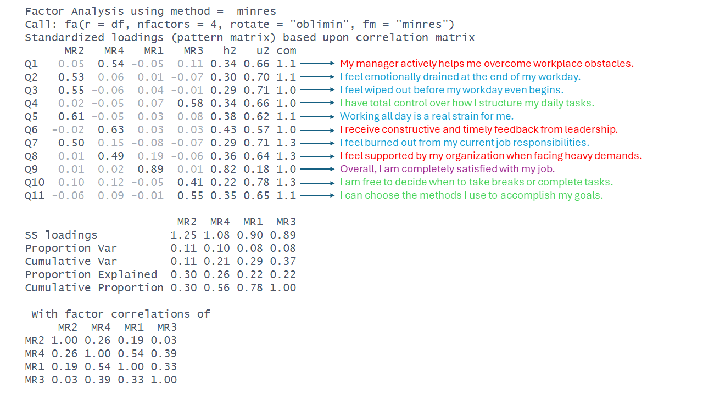
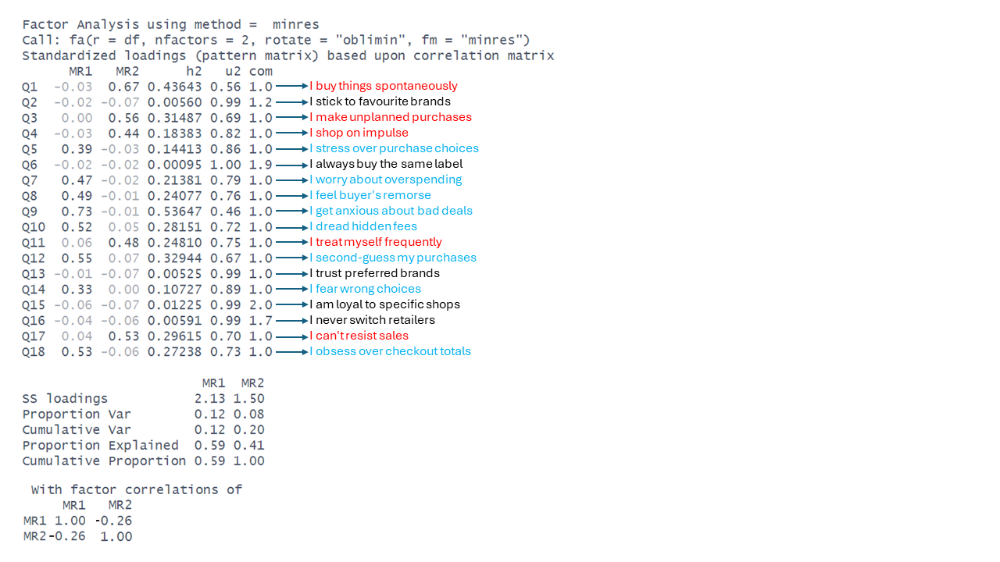
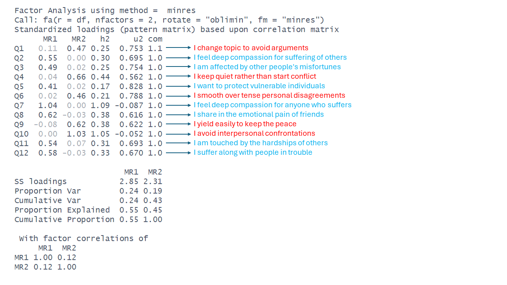
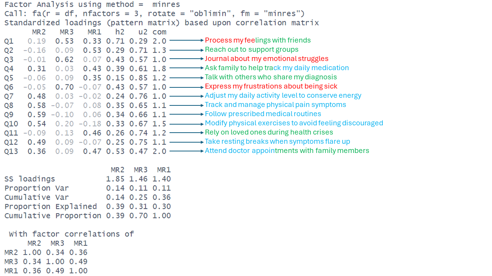
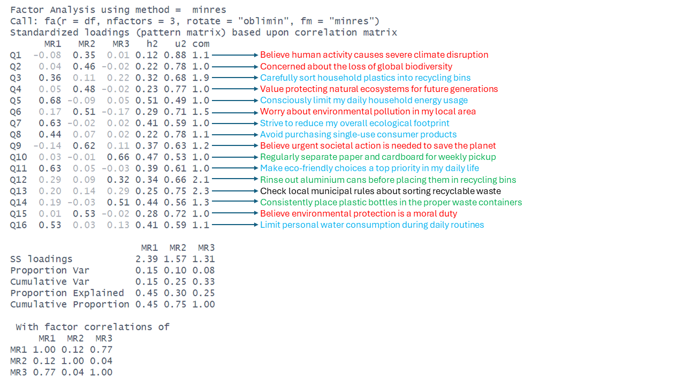

```{css, echo = FALSE}
.output {
max-height: 500px;
overflow-y: scroll;
}
```

```{r setup, include=F}
library(tidyverse)
library(patchwork)
library(psych)
source('_theme/theme_quarto.R')

theme_set(theme_quarto(title_font_size=42))
theme_update(
  text = element_text(family = 'Source Sans 3')
)

dapr3green <- "#88B04B" 
dapr3dkgreen <- "#5C7C28"
dapr3ltgreen <- "#E5EED7"
pal <- c( "#d35269", "#5c9ead","#2a3c24", "#F5C396", "#8B2635",  "#235789")


```

# Examples

Each of these is an example EFA fitted to a different dataset  
think about..  

- Are there too many factors? (how can you tell?) 
- Are there too few factors? (how can you tell?)
- Does everything look great?  
- Are there problematic items (how can you tell?)
- Are there impossible values
- What do the factors look like they might represent? (practice giving a name to each factor)

For some of these examples, more than one of the above may be true. 


## Example 1 - Job Satisfaction



## Example 1 - Job Satisfaction {.smaller}

- Probably too many factors 
    - why? MR1 (the third factor) has only 1 item on it

possible names:  

- MR2: burnout
- MR4: managerial support
- MR1: ?? it's just the one item 
- MR3: autonomy/freedom

next step: examine a 2 factor solution

## Example 2 - Consumer Behaviour



## Example 2 - Consumer Behaviour {.smaller}

- Probably too few factors
    - why? lots of items don't load on to any factors
    - for the non-loading items, we can see they're all about brand loyalty.  
    
possible names:

- MR1: impulse buying
- MR2: purcharse anxiety
- missing factor: brand loyalty

next steps: examine a 3 factor solution, or remove all those items if we don't want brand loyalty

## Example 3 - Compassion



## Example 3 - Compassion {.smaller}

- Heywood cases! We have factor loadings (and communalities - the `h2` column) that are >1 in size. 
  - this doesn't make sense, because when we square factor loadings, they are "% variance in item i explained by factor F". We can't explain >100% variance! 
possible names:

- MR1: conflict aversion
- MR2: empathy

next steps: refit the model with a different extraction method. re-examine the items to ensure that some of them are not redundant (this can happen often when we use scales with few response options).


## Example 4 - Health-related coping



## Example 4 - Health-related coping {.smaller}

- Problematic items? Too few factors?
    - why? quite a few items (Q1, Q4, Q13) cross-load onto multiple factors
    - this could be a sign the items are tapping into multiple constructs (bad items), or it could be a sign that there is another factor that is related to both these factors. 
    - the wordings help us see what's happening. 
    
possible names

- MR2: practical strategies
- MR3: emotional processing
- MR1: social support

the items that cross load are worded such that they tap into both things (e.g. *family* helping with a *practical strategy*)  


## Example 5 - Environmental Conscientiousness




## Example 5 - Environmental Conscientiousness 

<div style="font-size:.8em">

- problematic item (Q13 doesn't load on to any factor)?
- too many factors?   

The key to this one is that factors MR1 and MR3 are highly correlated (0.77), **and** they capture very similar things. 

possible names:

- MR1: environmental behaviours
- MR2: environmental concern
- MR3: environmental behaviours (specifically waste/recycling related?) 

Because they kind of capture the same thing, and they are highly correlated, we likely have too many factors here, when 1 would suffice. 

Note also that the problematic item Q13 is a) asking about behaviours and b) has loadings of 0.2 and 0.29 on these two factors.  
It's quite possible if we go down to a 2 factor model then this will load saliently on one of them.  

However, it is also quite a niche thing - checking rules. It might warrant further re-wording, especially if we want the scale to work in places where there aren't "municipalities"!  


next steps: examine a 2 factor solution, and consider re-wording items Q13 (and possibly some of the other ones which are very specific behaviours).  

</div>

