```{css, echo = FALSE}
.output {
max-height: 500px;
overflow-y: scroll;
}
```


```{r setup, include=F}
library(tidyverse)
library(patchwork)
library(psych)
source('_theme/theme_quarto.R')

theme_set(theme_quarto(title_font_size=42))
theme_update(
  text = element_text(family = 'Source Sans 3')
)

dapr3green <- "#88B04B" 
dapr3dkgreen <- "#5C7C28"
dapr3ltgreen <- "#E5EED7"
pal <- c( "#d35269", "#5c9ead","#2a3c24", "#F5C396", "#8B2635",  "#235789")
```


# CFA is a gateway... {transition="slide"}

**stuff beyond here definitely won't be in any assessment for DAPR3**   


## Structural Equation Models (SEM)

SEM models generally have:

- a structural part (relations between constructs of interest) 
- a measurement part (a model of how each construct is measured)

It all gets estimated at once! 

::::{.columns}
:::{.column width="50%"}
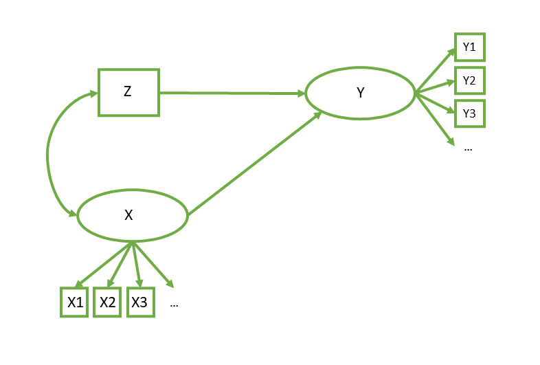
:::
:::{.column style="width:50%;font-size:1.2em"}
```
# measurement model
Y =~ y1 + y2 + y3 + ...
X =~ x1 + x2 + x3 + ...
# regressions
Y ~ X + Z
# covariances
X ~~ Z
```
:::
::::

## Why SEM?

::::{.columns}
:::{.column width="40%"}
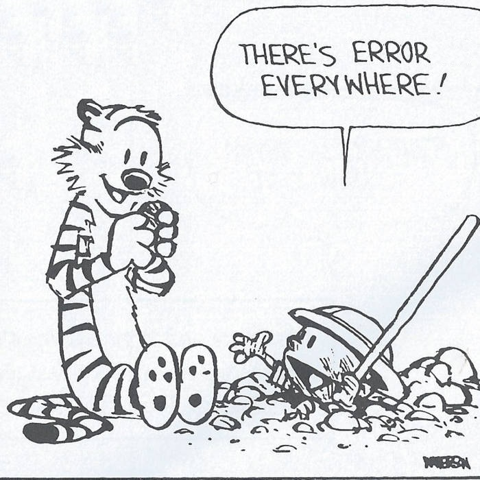
:::
:::{.column width="60%"}


1. Estimate paths between constructs while explicitly modelling measurement error
    - whenever we calculate/estimate a 'score' (scale scores, PCA scores, factor scores), and then use that in another analysis, we are assuming it is measured without error  
    
2. Offers a framework for testing theories (beyond just the CFA theories of measurement).  

:::

::::


## common uses of SEM

**"Nomological Net"**   
Do things correlate with other things we expect them to correlate with?  
*Good for assessing if our measure is measuring the thing we want it to measure!*


::::{.columns}
:::{.column width="50%"}
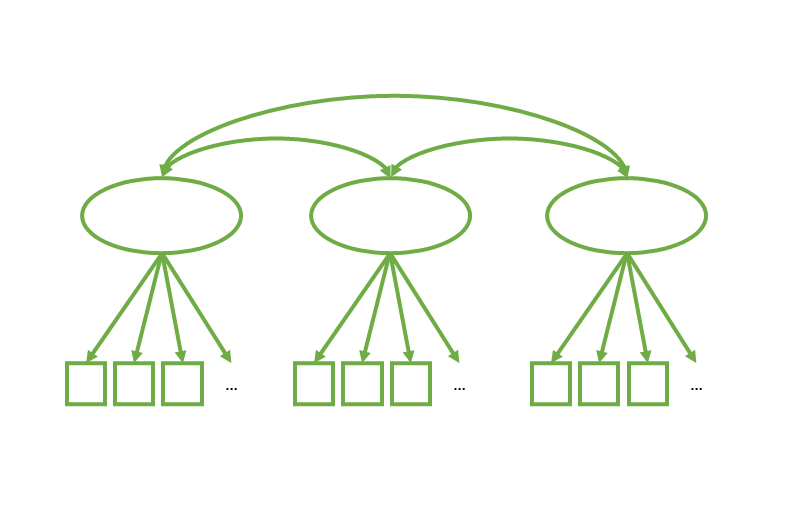
:::
:::{.column style="width:50%;font-size:1.2em"}
<br>
```
# measurement model
F1 =~ y1 + y2 + y3 + ...
F2 =~ x1 + x2 + x3 + ...
F3 =~ w1 + w2 + w3 + ...
# latent variable covariances
F1 ~~ F2
F1 ~~ F3
F2 ~~ F3
```
:::
::::


## common uses of SEM

**Measurement Invariance**  
Do factor loadings differ between groups/timepoints/contexts?

::::{.columns}
:::{.column width="50%"}
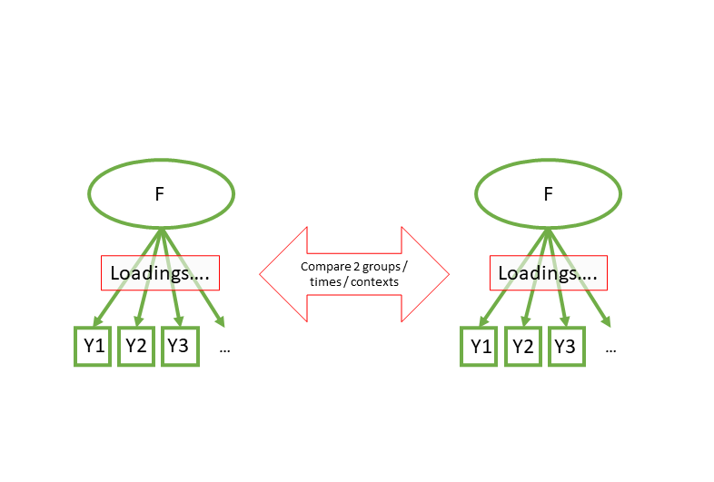
:::
:::{.column style="width:50%;font-size:1.2em"}
<br>
```
model <- "F1 =~ y1 + y2 + y3 + ..."
```
<br>
```
m1 <- cfa(model, data, group = "mygroups")
m2 <- cfa(model, data, group = "mygroups", 
                 group.equal = "loadings")  
  
semTools::compareFit(m1,m2)
```

:::
::::

## common uses of SEM

**Mediation**  
How much of X -> Y is because of X -> M and M -> Y?    

::::{.columns}
:::{.column width="50%"}
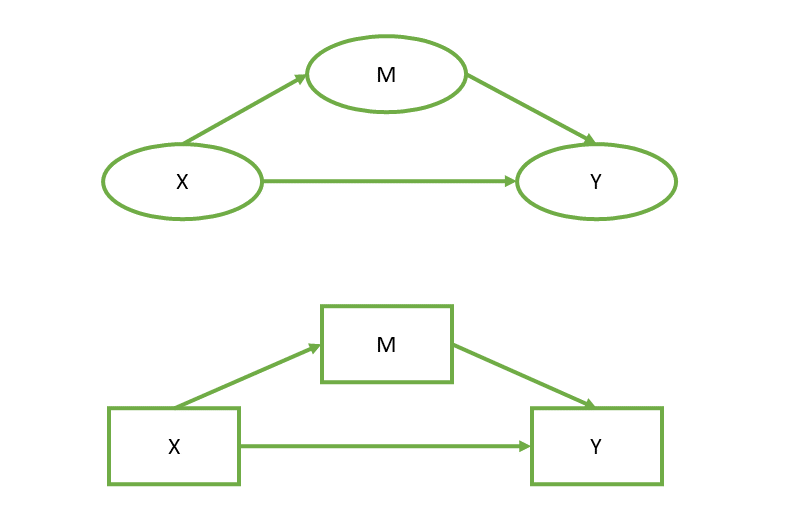

:::
:::{.column style="width:50%;font-size:1.2em"}
<br>
```
model <- "
  Y ~ a*M + c*X
  M ~ b*X
  indirect := a*b
  direct := c
"
```
```
sem(model, data)
```

:::
::::


:::{.myblock style="text-align:left;font-size:.7em"}

**&#x26A0;** mediation is almost always **incredibly** problematic. Many people will (possibly correctly) dismiss it altogether as useless because confounding is *everywhere*.  

Cross-sectional observational mediation is even worse ("three correlations in a trenchcoat"^[See Julia Rohrer's great blog post: https://www.the100.ci/2025/03/20/reviewer-notes-thats-a-very-nice-mediation-analysis-you-have-there-it-would-be-a-shame-if-something-happened-to-it/ ])


:::


## common uses of SEM

**Latent Growth Curves**  
The same as `lmer(Y ~ TimePoint + (1 + TimePoint | Person))`

::::{.columns}
:::{.column width="50%"}
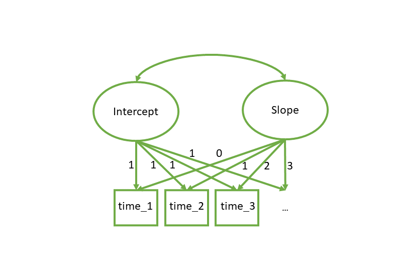

:::
:::{.column style="width:50%;font-size:1.2em"}
<br>
```
model <- "
  int =~ 1*Time1 + 1*Time2 + 1*Time3 + ...
  slope =~ 0*Time1 + 1*Time2 + 2*Time3 + ...
  int ~~ slope
"
```
```
growth(model, data)
```

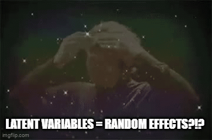

:::
::::

## the big big caution...   

- The idea of SEM originally is to build a model that reflects the theoretical data generating process  

- Too often, people force their data to a shape that fits with an off-the-shelf SEM structure  

- It's far too easy to estimate SEM models and report 'associations' while remaining blind to the strict causal assumptions required to give those paths real-world meaning

## diagrams

- diagrams are:  
  - for back of envelope thinking
  - for presenting to the reader your theory about how the data are generated

- SEM diagrams adhere to "covariance algebra" (linear paths imply a covariance matrix)
- diagrams more generally adhere to a system of formal logic of causality


## the logic of diagrams

::::{.columns}
:::{.column width="50%"}

::: {.r-stack}
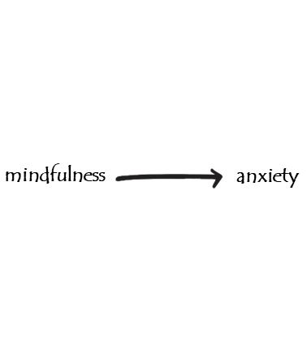

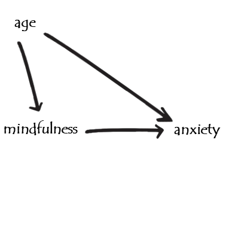{.fragment fragment-index=2}
:::

:::
:::{.column width="50%"}

```{r}
#| echo: false
#| fig-width: 10
#| fig-height: 3.5
set.seed(700)
df = tibble(
  age = runif(100,18,80),
  mfull = rbinom(100,1,plogis(-scale(age)*1.2)),
  Anx = rnorm(100,110-1*age - 10*mfull,5)
) |> mutate(mfull=factor(mfull,levels=0:1,labels=c("N","Y")))
m2 = lm(Anx~age+mfull,df)
p0 = ggplot(df,aes(x=mfull,y=Anx))+
  geom_jitter(width=.1,height=0,
              size=3,alpha=.6)+
  stat_summary(geom="pointrange",fatten=.5,
               position=position_nudge(x=.23))+
  theme_quarto(text_font_size = 26)

p1 = ggplot(df,aes(x=mfull,y=Anx,col=age))+
  geom_jitter(width=.1,height=0,
              size=3,alpha=.6)+
  scale_color_viridis_c(option="C")+
  stat_summary(geom="pointrange",fatten=.5,
               position=position_nudge(x=.23))+
  theme_quarto(text_font_size = 26)

p2 = ggplot(df,aes(x=age,y=Anx,col=mfull))+
  geom_point(size=3,alpha=.6)+
  geom_abline(intercept=coef(m2)[1],
              slope=coef(m2)[2],
              lwd=1,col="tomato")+
  geom_abline(intercept=coef(m2)[1]+coef(m2)[3],
              slope=coef(m2)[2],
              lwd=1,col="skyblue2")+
  theme_quarto(text_font_size = 26)
```

::: {.r-stack}
:::{.fragment fragment-index=1}
```{r}
#| echo: false
#| fig-width: 10
#| fig-height: 7.5
p0 + labs(title="lm(Anx~Mfull)")
```
:::
:::{.fragment fragment-index=2}
```{r}
#| echo: false
#| fig-width: 10
#| fig-height: 7.5
p1 + labs(title="lm(Anx~Mfull)")
```
:::
:::{.fragment fragment-index=3}
```{r}
#| echo: false
#| fig-width: 10
#| fig-height: 7.5
p2 + labs(title="lm(Anx~age+Mfull)")
```
:::
:::

:::
::::


## the logic of diagrams


::::{.columns}
:::{.column width="50%"}

::: {.r-stack}
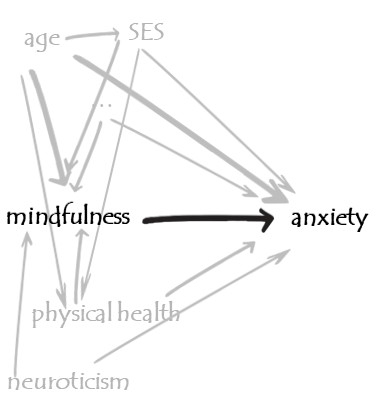

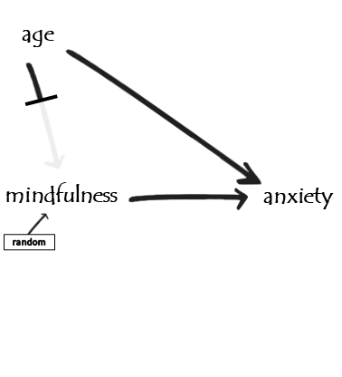{.fragment}
:::

:::
:::{.column width="50%"}

```{r}
#| echo: false
set.seed(62)
df = tibble(
  age = runif(100,18,80),
  mfull = rbinom(100,1,.5),
  Anx = rnorm(100,110-1*age - 10*mfull,5)
) |> mutate(mfull=factor(mfull,levels=0:1,labels=c("N","Y")))
m2 = lm(Anx~age+mfull,df)
p1 = ggplot(df,aes(x=mfull,y=Anx,col=age))+
  geom_jitter(width=.1,height=0,
              size=3,alpha=.6)+
  scale_color_viridis_c(option="C")+
  stat_summary(geom="pointrange",fatten=.5,
               position=position_nudge(x=.23))+
  theme_quarto(text_font_size = 26)

p2 = ggplot(df,aes(x=age,y=Anx,col=mfull))+
  geom_point(size=3,alpha=.6)+
  geom_abline(intercept=coef(m2)[1],
              slope=coef(m2)[2],
              lwd=1,col="tomato")+
  geom_abline(intercept=coef(m2)[1]+coef(m2)[3],
              slope=coef(m2)[2],
              lwd=1,col="skyblue2")+
  theme_quarto(text_font_size = 26)
```

::: {.r-stack}
:::{.fragment}
```{r}
#| echo: false
#| fig-width: 10
#| fig-height: 7.5
p1 + labs(title="lm(Anx~Mfull)")
```
:::
:::{.fragment}
```{r}
#| echo: false
#| fig-width: 10
#| fig-height: 7.5
p2 + labs(title="lm(Anx~age+Mfull)")
```
:::
:::

:::
::::


## the logic of diagrams

::::{.columns}
:::{.column width="50%"}

::: {.r-stack}
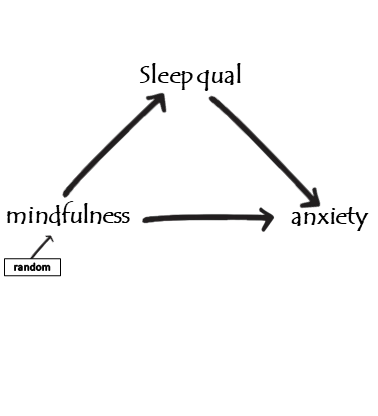
:::

:::
:::{.column width="50%"}

```{r}
#| echo: false
set.seed(44)
df = tibble(
  mfull = rbinom(100,1,.5),
  sleep = rnorm(100,+3*mfull,1),
  Anx = rnorm(100,60-3.5*sleep,5)
) |> mutate(mfull=factor(mfull,levels=0:1,labels=c("N","Y")))
m2 = lm(Anx~sleep+mfull,df)
p1 = ggplot(df,aes(x=mfull,y=Anx))+
  geom_jitter(width=.1,height=0,
              size=3,alpha=.6)+
  scale_color_viridis_c(option="C")+
  stat_summary(geom="pointrange",fatten=.5,
               position=position_nudge(x=.23))+
  theme_quarto(text_font_size = 26)

p2 = ggplot(df,aes(x=sleep,y=Anx,col=mfull))+
  geom_point(size=3,alpha=.6)+
  geom_abline(intercept=coef(m2)[1],
              slope=coef(m2)[2],
              lwd=1,col="tomato")+
  geom_abline(intercept=coef(m2)[1]+coef(m2)[3],
              slope=coef(m2)[2],
              lwd=1,col="skyblue2")+
  theme_quarto(text_font_size = 26)
```

::: {.r-stack}
:::{.fragment}
```{r}
#| echo: false
#| fig-width: 10
#| fig-height: 7.5
p1 + labs(title="lm(Anx~Mfull)")
```
:::
:::{.fragment}
```{r}
#| echo: false
#| fig-width: 10
#| fig-height: 7.5
p2 + labs(title="lm(Anx~sleep+Mfull)")
```
:::
:::

:::
::::

## the logic of diagrams

to estimate the "effect of X on Y", we need to isolate the flow of information from X to Y, along only the path(s) we are interested in.  

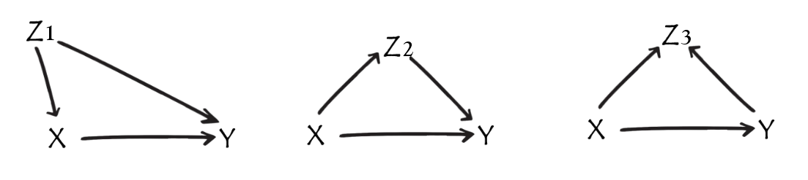{width="1000px"}

::::{.columns}
:::{.column width="33%"}

- path x&larr;z1&rarr;y is open
- controlling for z1 closes it  

:::
:::{.column width="33%"}

- path x&rarr;z2&rarr;y is open
- controlling for z2 closes it

:::
:::{.column width="33%"}

- path x&rarr;z3&larr;y is closed
- controlling for z3 opens it

:::
::::

:::{.fragment}
most common interpretation of "effect of X on Y": what happens to Y when X changes?  

- close the back-doors, keep causal front-doors open
- control for z1, don't control for z2 or z3. 

:::


## the logic of diagrams

- diagrams can help us figure out what to control for (and what not to control for)

- can help you consider (and be transparent about) limitations


:::{.aside}

For more on this, see:  

- Wysocki, A. C., Lawson, K. M., & Rhemtulla, M. (2022). Statistical control requires causal justification. Advances in Methods and Practices in Psychological Science, 5(2), 25152459221095823.
- Rohrer, J. M. (2024). Causal inference for psychologists who think that causal inference is not for them. Social and Personality Psychology Compass, 18(3), e12948.
- Cinelli, C., Forney, A., & Pearl, J. (2024). A crash course in good and bad controls. Sociological Methods & Research, 53(3), 1071-1104.
- VanderWeele, Tyler J. (2019). Principles of Confounder Selection. European Journal of Epidemiology 34 (3): 211–19.

:::

## the grey area

quite often... 

1. ask a question that is at least implicitly causal

2. do analysis, controlling for some stuff (often without clearly discussing why)

3. report "associations"

4. draw implicitly causal conclusions

5. emphasise everything is just correlations so can't make any causal conclusions, to maintain plausible deniability

## the grey area {.smaller}

- it's not clear what people actually mean by "x is associated with y"  

::::{.columns}
:::{.column width="25%"}
**Descriptive Qs**

- "does X tend to appear with Y?"  

if so, we probably don't want to control for other things.  


:::
:::{.column width="2%"}
:::
:::{.column width="46%"}
**Causal Qs**  

- "does X cause Y?"

we want to control for the things that allow us to get an unbiased estimate of what would happen to an observation's Y value if its X value changed.  

**Implicitly Causal Qs**  

- "does X influence Y?"
- "does X affect Y?"
- "does X explain Y?"
- "does X prevent Y?"
- "is Y due to X?"
- "does X increase/decrease Y?"
- "does X protect against Y?"
- "does X improve Y?"
- "does X make Y?"

:::
:::{.column width="2%"}
:::
:::{.column width="25%"}
**Associational Qs**  

- ???? 

:::
::::

## 

:::{.center-xy}
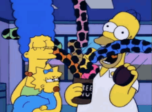{width="1000px"}
:::


