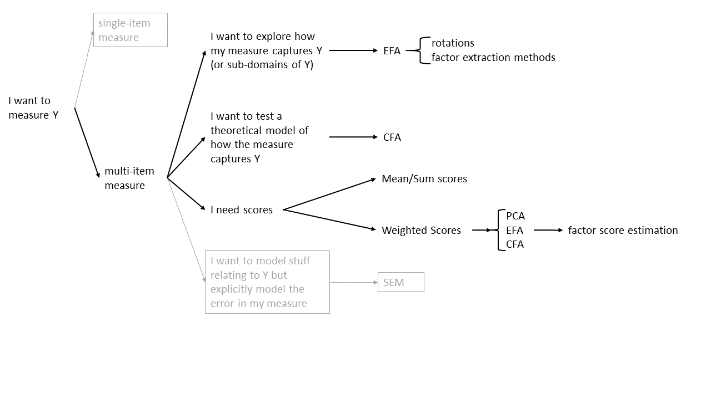
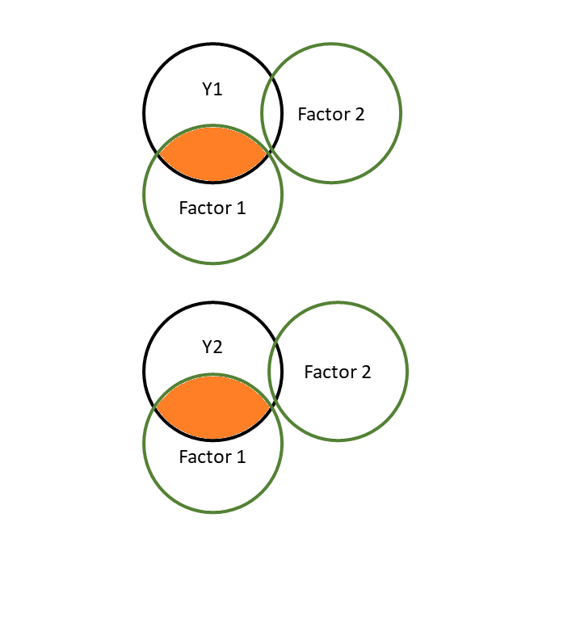
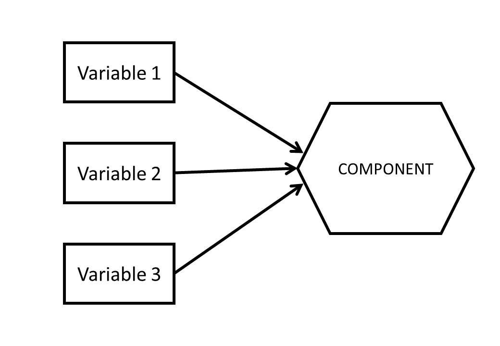
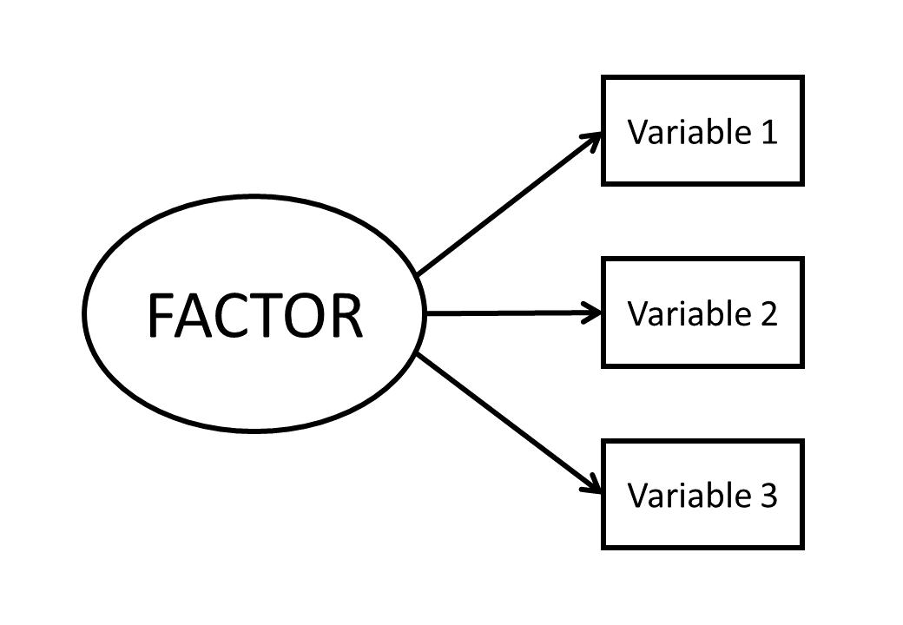
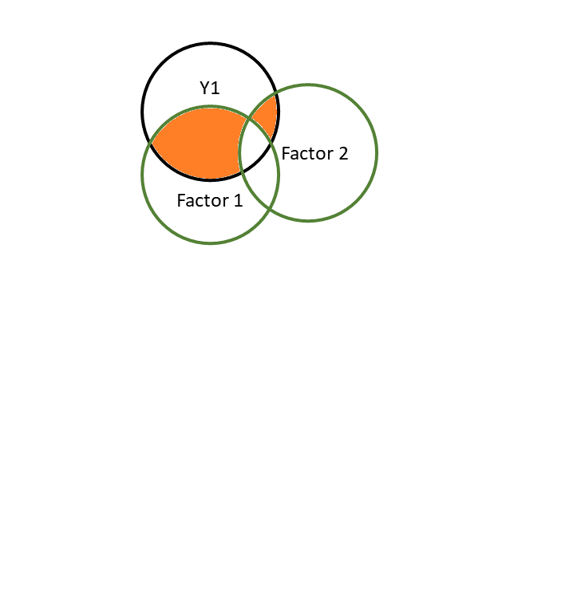
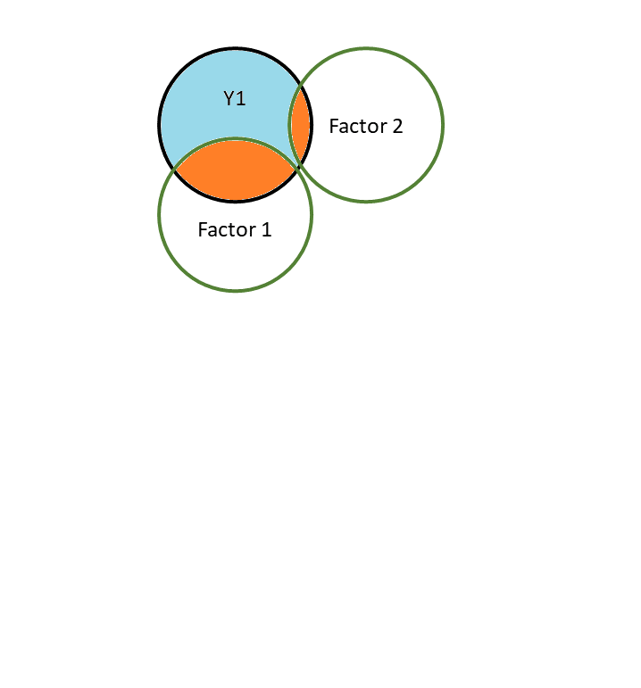
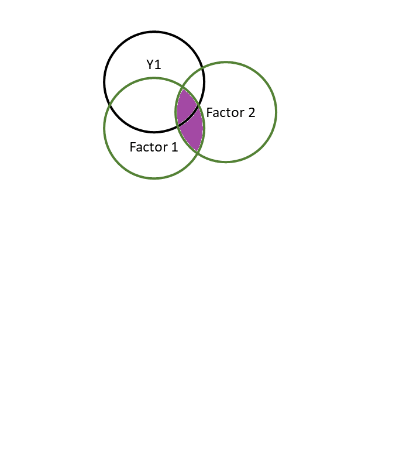
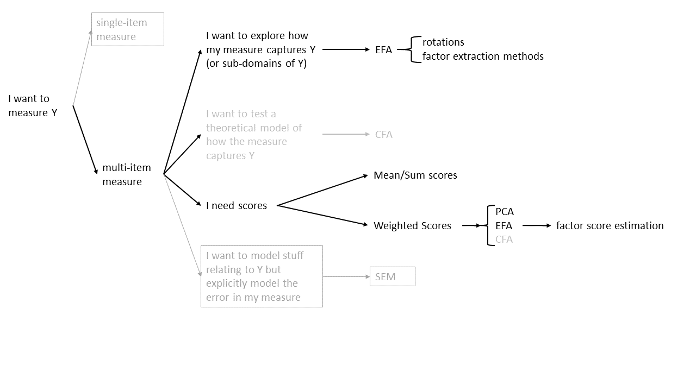
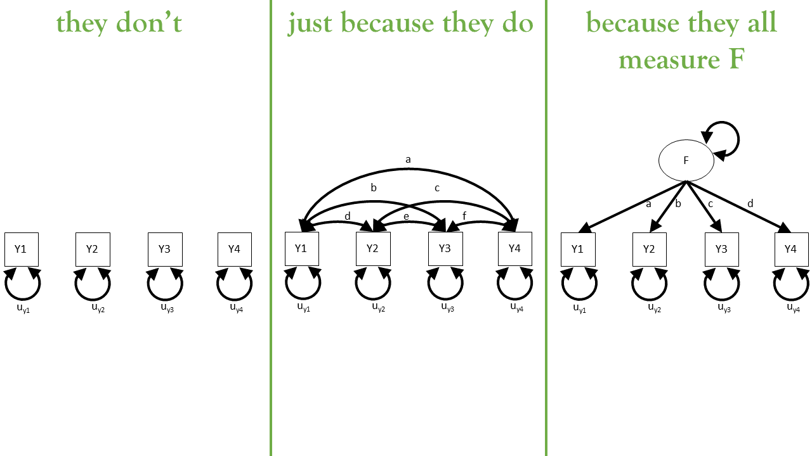

```{r}
#| label: setup
#| include: false
library(tidyverse)
library(patchwork)
library(psych)
library(lavaan)
source('_theme/theme_quarto.R')
```

# Course Overview

```{r}
#| results: "asis"
#| echo: false
block1_name = "Linear Mixed Models<br>(with Elizabeth Pankratz)"
block1_lecs = c("Regression refresher, intro to group-structured data",
                "Modelling group-structured data using random effects",
                "Interpreting LMMs and building maximal models",
                "Troubleshooting model fit, checking assumptions + diagnostics",
                "LMMs: Practice analysis")
block2_name = "Factor Analysis<br>working with multi-item measures<br>(with Josiah King)"
block2_lecs = c(
  "measurement and dimensionality",
  "exploring underlying constructs (EFA)",
  "testing theoretical models (CFA)",
  "reliability and validity",
  "recap & exam prep"
  )

#source("https://raw.githubusercontent.com/uoepsy/junk/refs/heads/main/R/course_table.R")
junk::course_table(block1_name,block2_name,block1_lecs,block2_lecs,week=10)
```


# This week {transition="slide"}

::::{.columns}
:::{.column width="50%"}
__Lecture__  

- Brief recap block 2
- Exam prep Q&A

:::
:::{.column width="50%"}
__Lab__

- Mock Exam Qs!  

:::
::::


# Broad ideas 

## multivariate


::::{.columns}
:::{.column width="50%"}
__mixed models__  

- multiple values per group
- each value is an observation

```{r}
#| echo: false
tibble(
  person = rep(1:3,e=3),
  y = "...",
  x = "...",
  ` ...`= "..."
) |> gt::gt()
```

:::
:::{.column width="50%"}
__psychometrics__  

- multiple values ($y1, ..., y_k$) representing the same construct
- the set of values is "an observation" of [construct]

```{r}
#| echo: false
tibble(
  person = c(1:3,"..."),
  y1 = c("..."),
  y2 = c("..."),
  y3 = c("..."),
  ` ...` = c("..."),
) |> gt::gt()
```

:::
::::

## two things..  

__scoring__  

**Q:** To do anything with [construct $Y$], how do we get one number to represent an observation of $Y$?  

- is one number enough - are $y1,y2,...,yk$ really unidimensional?  
- is it a valid and reliable measure of $Y$?
    
<br>
    
__understanding__  
    
**Q:** How does [set of scores $y1,y2,...,yk$] get at [construct $Y$]?  

- are the variables equally representative of $Y$?
- is there just one dimension to $Y$ or are there multiple?
    - what are they? are they correlated? 
    - how do they relate to $y1,y2,...,yk$?
- does *a priori* measurement model fit well in my sample?  
- is it a valid and reliable measure of $Y$?


## things we've explored...  

```{=html}
<iframe src="https://uoepsy.github.io/dapr3/2627/misc/block2_overview.html" width="100%" height="1580px" style="border:none; overflow:hidden;" scrolling="no"></iframe>
```

## things we've explored...  




## scoring multi-item measures


::::{.columns}
:::{.column width="50%"}
**scale scores**  
add 'em all up, you've got $Y$ 

- clinically 'meaningful'?  
- but only 'meaningful' if underlying model holds (which it almost definitely doesn't!)  
    
:::

:::{.column width="50%"}
**dimension reduction**  
identify smaller number of dimensions that capture how people vary across across the items.  
Where people fall on those dimensions = their score on $Y$.  

:::{.fragment}

- PCA: reduce to set of orthogonal dimensions sequentially capturing most variability.  
Scores are weighted composites of responses to items.  

- FA: explore (EFA) or test (CFA) model of underlying dimensions (possibly correlated) that explain variability in items.  
Scores are estimates of standing on latent factor(s).    

:::

:::
::::


## understanding multi-item measures

::::{.columns}
:::{.column width="50%"}

:::

:::{.column width="50%"}
**dimension reduction**  

:::{style="opacity:.4"}
identify smaller number of dimensions that capture how people co-vary across across the items.  
Where people fall on those dimensions = their score on $Y$.  

- PCA: reduce to set of orthogonal dimensions sequentially capturing most variability.  
Scores are weighted composites of responses to items.  

::: 

- FA: explore (EFA) or test (CFA) model of underlying dimensions (possibly correlated) that explain variability in items.  

:::
::::

## understanding multi-item measures

$$
\begin{align}
\text{Outcome} &=& \text{Model} &\quad + \quad& \text{Error} \\
\quad \\
\text{observed cov/cor} &=& \text{factor loadings and} &\quad + \quad& \text{unique variance for} \\
\text{matrix of items}& &\text{factor correlations} &\quad \quad& \text{each item} \\
\end{align}
$$

# dimensions

## the idea  

cov/cor between items can reflect the extent to which items 'measure the same thing'

::::{.columns}
:::{.column width="33%"}
Three variables measuring unrelated things: 

Rate agreement on:  

- Q1: I am the life and soul of the party
- Q2: I like penguins
- Q3: I enjoy studying statistics


```{r}
#| echo: false
library(rgl)
library(psych)
set.seed(4)
R = matrix(c(1,.0,0,
             0,1,0,
             0,0,1),nrow=3)
Sigma = diag(3)%*%R%*%diag(3)
Mean <- rep(0,3)
x <- MASS::mvrnorm(500, Mean, Sigma)
x <- apply(x,2,\(x) as.numeric(cut(x,9)))
mydata <- as.data.frame(x)
names(mydata) <- c("M","P","S")
plot3d(x, box = FALSE, 
       xlab="Q1",ylab="Q2",zlab="Q3")
# plot3d(ellipse3d(cov(mydata), centre = colMeans(mydata)), col = "#A41AE4", alpha = 0.4, add = TRUE)
rglwidget()
```

:::
:::{.column width="33%"}
Three variables perfectly measuring the exact same thing

Time spent looking at phone last week:

- In hours
- In days
- In weeks


```{r}
#| echo: false
set.seed(4)
xx <- runif(100,0,7*24)
x <- cbind(xx, xx/24, xx/24/7)
mydata <- as.data.frame(x)
names(mydata) <- c("M","P","S")
plot3d(x, box = FALSE, 
       xlab="hours",ylab="days",zlab="weeks")
rglwidget()

```
:::
:::{.column width="33%"}
Three variables measuring the same thing but differently

Rate agreement on:  

- Q1: I think cake is the best food
- Q2: I feel great when I eat cake
- Q3: I often eat cake


```{r}
#| echo: false

set.seed(4)
R = matrix(c(1,.7,.7,
             .7,1,.7,
             .7,.7,1),nrow=3)
Sigma = diag(3)%*%R%*%diag(3)
Mean <- rep(0,3)
x <- MASS::mvrnorm(500, Mean, Sigma)
x <- apply(x,2,\(x) as.numeric(cut(x,9)))
mydata <- as.data.frame(x)
names(mydata) <- c("M","P","S")
plot3d(x, box = FALSE, 
       xlab="Q1",ylab="Q2",zlab="Q3")
# plot3d(ellipse3d(cov(mydata), centre = colMeans(mydata)), col = "#A41AE4", alpha = 0.4, add = TRUE)
rglwidget()
```

:::
::::


## the idea  

cov/cor between items can reflect the extent to which items 'measure the same thing'

::::{.columns}
:::{.column width="33%"}
Three variables measuring unrelated things: 

Rate agreement on:  

- Q1: I am the life and soul of the party
- Q2: I like penguins
- Q3: I enjoy studying statistics

```{r}
set.seed(4)
R = matrix(c(1,.0,0,
             0,1,0,
             0,0,1),nrow=3)
Sigma = diag(3)%*%R%*%diag(3)
Mean <- rep(0,3)
x <- MASS::mvrnorm(500, Mean, Sigma)
x <- apply(x,2,\(x) as.numeric(cut(x,9)))
mydata <- as.data.frame(x)
names(mydata) <- c("M","P","S")
plot3d(x, box = FALSE, 
       xlab="Q1",ylab="Q2",zlab="Q3")
plot3d(ellipse3d(cov(mydata), centre = colMeans(mydata)), col = "#A41AE4", alpha = 0.4, add = TRUE)
plot3d(
  abclines3d(mean(mydata$M),mean(mydata$P),mean(mydata$S),
             a=principal(x,nfactors=3,cov=TRUE,rotate="none")$loadings[,1],
             col="green"),lwd=2, add=TRUE)
plot3d(
  abclines3d(mean(mydata$M),mean(mydata$P),mean(mydata$S),
             a=principal(x,nfactors=3,cov=TRUE,rotate="none")$loadings[,2],
             col="red"), lwd=2, add=TRUE)
plot3d(
  abclines3d(mean(mydata$M),mean(mydata$P),mean(mydata$S),
    a=principal(x,nfactors=3,cov=TRUE,rotate="none")$loadings[,3],
           col="blue"), lwd=2, add=TRUE)
rglwidget()


set.seed(4)
xx <- runif(100,0,7*24)
x <- cbind(xx, xx/24, xx/24/7)
mydata <- as.data.frame(x)
names(mydata) <- c("M","P","S")
plot3d(x, box = FALSE, 
       xlab="hours",ylab="days",zlab="weeks")
plot3d(
  abclines3d(0,0,0,
             a=c(1,1/24,1/24/7),
             col="green"),lwd=2, add=TRUE)
rglwidget()

set.seed(4)
R = matrix(c(1,.7,.7,
             .7,1,.7,
             .7,.7,1),nrow=3)
Sigma = diag(3)%*%R%*%diag(3)
Mean <- rep(0,3)
x <- MASS::mvrnorm(500, Mean, Sigma)
x <- apply(x,2,\(x) as.numeric(cut(x,9)))
mydata <- as.data.frame(x)
names(mydata) <- c("M","P","S")
plot3d(x, box = FALSE, 
       xlab="Q1",ylab="Q2",zlab="Q3")
plot3d(ellipse3d(cov(mydata), centre = colMeans(mydata)), col = "#A41AE4", alpha = 0.4, add = TRUE)
plot3d(
  abclines3d(mean(mydata$M),mean(mydata$P),mean(mydata$S),
             a=principal(x,nfactors=3,cov=TRUE,rotate="none")$loadings[,1],
             col="green"),lwd=2, add=TRUE)
plot3d(
  abclines3d(mean(mydata$M),mean(mydata$P),mean(mydata$S),
             a=principal(x,nfactors=3,cov=TRUE,rotate="none")$loadings[,2],
             col="red"), lwd=2, add=TRUE)
plot3d(
  abclines3d(mean(mydata$M),mean(mydata$P),mean(mydata$S),
    a=principal(x,nfactors=3,cov=TRUE,rotate="none")$loadings[,3],
           col="blue"), lwd=2, add=TRUE)
rglwidget()
```
:::
:::{.column width="33%"}
Three variables perfectly measuring the exact same thing

Time spent looking at phone last week:

- In hours
- In days
- In weeks

```{r}
set.seed(4)
xx <- runif(100,0,7*24)
x <- cbind(xx, xx/24, xx/24/7)
mydata <- as.data.frame(x)
names(mydata) <- c("M","P","S")
plot3d(x, box = FALSE, 
       xlab="hours",ylab="days",zlab="weeks")
plot3d(
  abclines3d(0,0,0,
             a=c(1,1/24,1/24/7),
             col="green"),lwd=2, add=TRUE)
rglwidget()
```
:::
:::{.column width="33%"}
Three variables measuring the same thing but differently

Rate agreement on:  

- Q1: I think cake is the best food
- Q2: I feel great when I eat cake
- Q3: I often eat cake

```{r}
set.seed(4)
R = matrix(c(1,.7,.7,
             .7,1,.7,
             .7,.7,1),nrow=3)
Sigma = diag(3)%*%R%*%diag(3)
Mean <- rep(0,3)
x <- MASS::mvrnorm(500, Mean, Sigma)
x <- apply(x,2,\(x) as.numeric(cut(x,9)))
mydata <- as.data.frame(x)
names(mydata) <- c("M","P","S")
plot3d(x, box = FALSE, 
       xlab="Q1",ylab="Q2",zlab="Q3")
plot3d(ellipse3d(cov(mydata), centre = colMeans(mydata)), col = "#A41AE4", alpha = 0.4, add = TRUE)
plot3d(
  abclines3d(mean(mydata$M),mean(mydata$P),mean(mydata$S),
             a=principal(x,nfactors=3,cov=TRUE,rotate="none")$loadings[,1],
             col="green"),lwd=2, add=TRUE)
plot3d(
  abclines3d(mean(mydata$M),mean(mydata$P),mean(mydata$S),
             a=principal(x,nfactors=3,cov=TRUE,rotate="none")$loadings[,2],
             col="red"), lwd=2, add=TRUE)
plot3d(
  abclines3d(mean(mydata$M),mean(mydata$P),mean(mydata$S),
    a=principal(x,nfactors=3,cov=TRUE,rotate="none")$loadings[,3],
           col="blue"), lwd=2, add=TRUE)
rglwidget()
```
:::
::::


## the idea  

cov/cor between items can reflect the extent to which items 'measure the same thing'

::::{.columns}
:::{.column width="33%"}
Three variables measuring unrelated things: 

Rate agreement on:  

- Q1: I am the life and soul of the party
- Q2: I like penguins
- Q3: I enjoy studying statistics

```{r}
set.seed(4)
R = matrix(c(1,.0,0,
             0,1,0,
             0,0,1),nrow=3)
Sigma = diag(3)%*%R%*%diag(3)
Mean <- rep(0,3)
x <- MASS::mvrnorm(500, Mean, Sigma)
x <- apply(x,2,\(x) as.numeric(cut(x,9)))
mydata <- as.data.frame(x)
names(mydata) <- c("M","P","S")
plot3d(x, box = FALSE, 
       xlab="Q1",ylab="Q2",zlab="Q3")
plot3d(ellipse3d(cov(mydata), centre = colMeans(mydata)), col = "#A41AE4", alpha = 0.4, add = TRUE)
plot3d(
  abclines3d(mean(mydata$M),mean(mydata$P),mean(mydata$S),
             a=principal(x,nfactors=3,cov=TRUE,rotate="none")$loadings[,1],
             col="green"),lwd=2, add=TRUE)
plot3d(
  abclines3d(mean(mydata$M),mean(mydata$P),mean(mydata$S),
             a=principal(x,nfactors=3,cov=TRUE,rotate="none")$loadings[,2],
             col="red"), lwd=2, add=TRUE)
plot3d(
  abclines3d(mean(mydata$M),mean(mydata$P),mean(mydata$S),
    a=principal(x,nfactors=3,cov=TRUE,rotate="none")$loadings[,3],
           col="blue"), lwd=2, add=TRUE)
rglwidget()
```


:::
:::{.column width="33%"}
Three variables perfectly measuring the exact same thing

Time spent looking at phone last week:

- In hours
- In days
- In weeks

```{r}
set.seed(4)
xx <- runif(100,0,7*24)
x <- cbind(xx, xx/24, xx/24/7)
mydata <- as.data.frame(x)
names(mydata) <- c("M","P","S")
plot3d(x, box = FALSE, 
       xlab="hours",ylab="days",zlab="weeks")
plot3d(
  abclines3d(0,0,0,
             a=c(1,1/24,1/24/7),
             col="green"),lwd=2, add=TRUE)
rglwidget()
```

:::
:::{.column width="33%"}
Three variables measuring the same thing but differently

Rate agreement on:  

- Q1: I think cake is the best food
- Q2: I feel great when I eat cake
- Q3: I enjoy studying statistics

```{r}
set.seed(4)
R = matrix(c(1,.7,.0,
             .7,1,.0,
             .0,.0,1),nrow=3)
Sigma = diag(3)%*%R%*%diag(3)
Mean <- rep(0,3)
x <- MASS::mvrnorm(500, Mean, Sigma)
x <- apply(x,2,\(x) as.numeric(cut(x,9)))
mydata <- as.data.frame(x)
names(mydata) <- c("M","P","S")
plot3d(x, box = FALSE, 
       xlab="Q1",ylab="Q2",zlab="Q3")
plot3d(ellipse3d(cov(mydata), centre = colMeans(mydata)), col = "#A41AE4", alpha = 0.4, add = TRUE)
plot3d(
  abclines3d(mean(mydata$M),mean(mydata$P),mean(mydata$S),
             a=principal(x,nfactors=3,cov=TRUE,rotate="none")$loadings[,1],
             col="green"),lwd=2, add=TRUE)
plot3d(
  abclines3d(mean(mydata$M),mean(mydata$P),mean(mydata$S),
             a=principal(x,nfactors=3,cov=TRUE,rotate="none")$loadings[,2],
             col="red"), lwd=2, add=TRUE)
plot3d(
  abclines3d(mean(mydata$M),mean(mydata$P),mean(mydata$S),
    a=principal(x,nfactors=3,cov=TRUE,rotate="none")$loadings[,3],
           col="blue"), lwd=2, add=TRUE)
rglwidget()
```

:::
::::


## the idea  

cov/cor between items can reflect the extent to which items 'measure the same thing'

::::{.columns}
:::{.column width="50%"}

- people vary in lots of ways over k variables  
- capture the ways in which people vary.  

```{r}
#| echo: false
set.seed(4)
R = matrix(c(1,.7,.0,
             .7,1,.0,
             .0,.0,1),nrow=3)
Sigma = diag(3)%*%R%*%diag(3)
Mean <- rep(0,3)
x <- MASS::mvrnorm(500, Mean, Sigma)
x <- apply(x,2,\(x) as.numeric(cut(x,9)))
mydata <- as.data.frame(x)
names(mydata) <- c("cake = best","cake feels great","enjoy stats")

```


:::

:::{.column width="50%"}

```{r}
#| echo: false
#| fig-height: 8
pairs(mydata)
```

:::
::::


## the idea  

cov/cor between items can reflect the extent to which items 'measure the same thing'

::::{.columns}
:::{.column width="50%"}

- people vary in lots of ways over k variables  
- capture the ways in which people vary.  

```{r}
#| echo: false
set.seed(3841)
RR = matrix(c(1,.7,.7,.2,.2,.2,
              .7,1,.7,.4,.2,.2,
              .7,.7,1,.2,.2,.2,
              .2,.4,.2,1,.7,.7,
              .2,.2,.2,.7,1,.7,
              .2,.2,.2,.7,.7,1
), nrow=6)

dff = cbind(
  MASS::mvrnorm(n=100,mu=rep(0,6),Sigma = RR)
) |> as.data.frame()
names(dff) <- paste0("y",c(3,1,2,4,5,6))

somedata <- dff |> select(y1,y2,y3,y4,y5,y6)
```


:::

:::{.column width="50%"}

```{r}
#| echo: false
#| fig-height: 8
pairs(dff)
```

:::
::::

## the idea  

cov/cor between items can reflect the extent to which items 'measure the same thing'

::::{.columns}
:::{.column width="50%"}

- people vary in lots of ways over k variables  
- capture the ways in which people vary.  


:::

:::{.column width="50%"}

```{r}
#| echo: false
cor(dff) |> round(2) |> knitr::kable()
```

:::
::::

# dimension reduction 

## what do we get out?

broadly:

- **direction**: relationships between observed variables and our new dimensions  

- **magnitude**: amount of variance captured/explained by each dimension

## direction - loadings

::::{.columns}
:::{.column width="50%"}
```{r}
#| eval: false
#| echo: true
library(psych)
principal(somedata, nfactors=6, rotate="none")
```
```{r}
#| echo: false
library(psych)
.pp(principal(somedata, nfactors=6, rotate="none"),top=10)
```

:::

:::{.column width="50%"}
__loadings__  

- `cor(item, component)`  

- squared loading gives variance in the item captured in the component


:::
::::

## magnitude: SSloadings 

::::{.columns}
:::{.column width="50%"}
```{r}
#| eval: false
#| echo: true
library(psych)
principal(somedata, nfactors=6, rotate="none")
```
```{r}
#| echo: false
library(psych)
.pp(principal(somedata, nfactors=6, rotate="none"),top=13)
```

:::

:::{.column width="50%"}
__SSloadings__  

- "sum of squared loadings"  

- take all loadings, square them, add them up.  

TODO change to component

      
:::
::::

## SSloadings & Variance Accounted for

::::{.columns}
:::{.column width="50%"}
```{r}
#| eval: false
#| echo: true
library(psych)
principal(somedata, nfactors=6, rotate="none")
```
```{r}
#| echo: false
library(psych)
.pp(principal(somedata, nfactors=6, rotate="none"),top=15)
```

:::

:::{.column width="50%"}
__"Variance Accounted For"__  

- Total variance = number of items

- $\frac{\text{SSloadings}}{\text{nr items}}$ = variance captured by each component
      
:::
::::


## SSloadings & Variance Accounted for

```{r}
#| fig-height: 8
scree(somedata, factor = F)
```


## PCA 

::::{.columns}
:::{.column width="50%"}
```{r}
#| eval: false
#| echo: true
library(psych)
principal(somedata, nfactors=6, rotate="none")
```
```{r}
#| echo: false
library(psych)
.pp(principal(somedata, nfactors=6, rotate="none"),top=15)
```

:::

:::{.column width="50%"}

- Essentially a calculation 
- Re-expresses $k$ items as $k$ orthogonal dimensions (components) the sequentially capture most variance
- We decide to keep a subset of components based on:  
    - how many things we ultimately want
    - how much variance is captured
- Theory about *what* the dimensions *are* doesn't really matter
      
:::
::::

## conceptual shift to EFA  

::::{.columns}
:::{.column width="50%"}
```{r}
#| eval: false
#| echo: true
library(psych)
fa(somedata, nfactors=2, rotate="oblimin")
```
```{r}
#| echo: false
library(psych)
.pp(fa(somedata, nfactors=2, rotate="oblimin"),top=17)
```

:::

:::{.column width="50%"}

- Is a **model** (set of parameters are estimated)
- ~~"variance captured by components"~~ 
- "variance explained by factors"  
- We choose a model that best explains our observed relationships
    - numerically (i.e. distinct factors that each capture something shared across items)
    - theoretically (i.e. factors make sense)
- we often apply a "rotation" to make it more interpretable
    - and to allow factors to be correlated

:::
::::


## EFA compared to PCA  

- Pretty much the same idea: captures relations between items and dimensions, and variance explained by dimensions  

- **BUT** - the aim is to *explain*, not just reduce  
    - best explanation becomes theory driven, and is focused on having a "simple structure" (think: clearly defined dimensions).  


::::{.columns}
:::{.column width="50%"}


:::
:::{.column width="50%"}


:::
::::
    
## common variance

TODO explain common var vs all var


## The point of PCA/EFA

::::{.columns}
:::{.column width="50%"}


- To reduce dimensionality

:::{.fragment fragment-index=1}

- to just 1 dimension  
- to however many dimensions required to keep "most of the variance"  

:::
:::
:::{.column width="50%"}

- To understand what (and how many) dimensions we are measuring.  

:::{.fragment fragment-index=2}

- requires comparing models with different numbers of factors
- evaluation of models is both numerical _and_ theoretical  

:::

:::
::::

## factor loadings


::::{.columns}
:::{.column width="50%"}
```{r}
#| eval: false
#| echo: true
library(psych)
fa(somedata, nfactors=2, rotate="oblimin", fm="ml")$loadings
```
```{r}
#| echo: false
library(psych)
.pp(fa(somedata, nfactors=2, rotate="oblimin", fm="ml")$loadings |> print(cutoff=0),top=14)
```

:::

:::{.column width="50%"}

- like `lm(item ~ F1 + F2 + ...) |> coef()`  
<span style="font-size:.7em">*(where items and Factors are standardised)*</span>  

- squared loading gives variance in item **uniquely** explained by the factor  



:::
::::

## h2, u2


::::{.columns}
:::{.column width="50%"}
```{r}
#| eval: false
#| echo: true
library(psych)
fa(somedata, nfactors=2, rotate="varimax")
```
```{r}
#| echo: false
library(psych)
.pp(fa(somedata, nfactors=2, rotate="varimax"),top=14)
```

:::

:::{.column width="50%"}

__Communalities (h2) & Uniqueness (u2):__   

- **h2**: Variance in an item explained by all factors  
- **u2**: Unexplained variance in an item  


- `lm(item ~ F1 + F2 + ...)`  
<span style="font-size:.7em">*(where items and Factors are standardised)*</span>  
    - Communality = $R^2$
    - Uniqueness = $1-R^2$

TODO fix oblique



:::
::::


## factor correlations

::::{.columns}
:::{.column width="50%"}
```{r}
#| eval: false
#| echo: true
library(psych)
fa(somedata, nfactors=2, rotate="oblimin", fm="ml")
```
```{r}
#| echo: false
library(psych)
.pp(fa(somedata, nfactors=2, rotate="oblimin", fm="ml")$loadings |> print(cutoff=0), top=14)
.pp(fa(somedata, nfactors=2, rotate="oblimin", fm="ml"),l=c(19))
fa(somedata, nfactors=2, rotate="oblimin", fm="ml")$Phi
```

:::

:::{.column width="50%"}
__Factor Correlations__  

`cor(Factor1, Factor2)`  



:::
::::


## EFA output and rotations


$$
\begin{align}
\text{Outcome} &=& \text{Model} &\quad + \quad& \text{Error} \\
\quad \\
\text{observed cov/cor} &=& \text{factor loadings} &\quad + \quad& \text{unique variance for} \\
\text{matrix of items}& &\text{factor correlations} &\quad \quad& \text{each item} \\
\end{align}
$$

<br>

- think of a rotation as a transformation applied to the factor loadings that may result in a non-zero correlation between factors
- it doesn't change the numerical 'fit' of the model, but it changes the interpretation
  - why? 
      - to find a cleaner (more interpretable) set of loadings
      - because the dimensions we expect would likely be correlated  
  
## what we want in a good EFA


## 

:::{.r-stack}



:::{.fragment}

:::

:::

# CFA

## theories of what and how a tool measures thing(s)

::::{.columns}
:::{.column width="50%"}
__EFA__  

Goal: discovery / theory generation

- let all items load on all factors
- aim is to get a simple structure
    - each item has one primary loading and its other loadings are small/negligible

:::
:::{.column width="50%"}
__CFA__  

Goal: theory testing

- set specific items to load on specific factors
    - and do **not** load onto others  
- aim is to test if the model does a good job of capturing the observed relationships in the data

:::
::::

## why do y1, ..., y4 covary with one another? 




## results  

1. does the model fit well?  
    - how well can it reproduce the observed covariance matrix?
2. are the loadings big enough?  
3. and then we might focus more on the relationships between the latent factors (because these are of interest)  

# Underlying considerations about measurement

## Q: is a measurement tool reliable?

**Am I consistently actually *measuring* a thing?**   

::::{.columns}
:::{.column width="50%"}

- this is all necessary because of measurement error  
    - with perfect measurement we would only need one variable

- more measurement error >>> lower reliability  
    - sometimes i'm scored too high, sometimes too low, etc..  noise!
    
- Reliability is a precursor to validity; a test cannot be valid if it is not reliable.  
:::

:::{.column width="50%" .fragment}

- lots of different ways to investigate reliability
    - test-retest
    - parallel forms
    - inter-rater
    - internal consistency (i.e. within a multi-item measure)
        - $\alpha$ (assumes equal loadings)
        - $\omega$ (based on factor model)
        
:::
::::


  


## Q: is a measurement tool valid?  

**Am I measuring the thing I think I'm measuring?**  

- Lots of different types:  
    - face validity
    - content validity
    - convergent validity
    - discriminant validity
    - predictive validity
- some are assessed through studying the measurement scale and how it is interpreted    
- some can be assessed through expected relations with other constructs  


# Thank you! 


